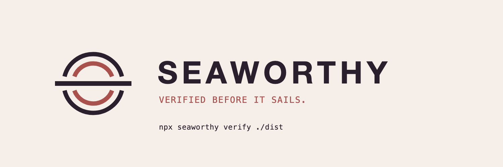

<p align="center">
  <picture>
    <source media="(prefers-color-scheme: dark)" srcset="brand/exports/banner-dark.png">
    
  </picture>
</p>

# Seaworthy

**Ship sites agents can trust.**

Seaworthy verifies websites for agents. One command checks any built static site, from any framework and on any host, and returns a versioned report that a coding agent can act on: every finding has a stable ID, an exact location, and a fix hint.

```bash
npx seaworthy verify ./dist
```

> **Status: pre-alpha.** Nothing above works yet. This repository is being built in public, task by task. See the [roadmap](ROADMAP.md).

## Why

Coding agents now build and edit websites all day. They say "done" when the code compiles, not when the site works. Broken links, a wrong base URL, missing alt text, a page agents can't read: these ship every day because nothing checks the built output.

Seaworthy is that check. It is built for the loop agents already run: change, verify, read the findings, fix, verify again.

## What it will do

- **Verify, don't advise.** Every check passes or fails with a location and a fix hint. No vague scores without reasons.
- **Any framework.** Seaworthy reads the built site (HTML and assets), so it works with Jekyll, Astro, Docusaurus, Hugo, VitePress, Next.js static export, MkDocs, or plain HTML.
- **Agent-native.** The same checks through a CLI, an MCP server, Agent Skills, and a GitHub Action, always with machine-readable output.
- **Agent-readable sites.** Checks that agents and AI search can read your site, built on existing standards: `llms.txt`, schema.org, Markdown alternates.
- **Adoptable today.** A baseline file lets a site with hundreds of existing issues adopt Seaworthy and fail only on new ones.
- **Extensible for years.** Check packs, presets, and integrations arrive through a versioned extension API.

Seaworthy checks the build folder before deploy, and from the second launch wave also the live site after it. An editorial, RTL-ready reference theme that passes every check is being built as a separate project.

## Roadmap

| Phase | When | What |
|---|---|---|
| 0 | Oct 2026 | Foundations and feasibility spikes |
| 1 | Nov 2026 | Verify engine and first checks |
| 2 | Dec 2026 | MCP server, Agent Skills, GitHub Action |
| 3 | Jan 2027 | Framework integrations, agent benchmark, private beta |
| 4 | Feb 2027 | **Launch: Seaworthy verify 0.1** |
| 5 | Mar 2027 | **Launch: live-site verification and the agent loop** |
| 6 | Apr 2027 | Extension API and open spec 0.9 |

Full detail, with every epic and task: [ROADMAP.md](ROADMAP.md).

## Contributing

Work is split into small issues with lanes for newcomers, experienced contributors, and coding agents. Start with [CONTRIBUTING.md](CONTRIBUTING.md) and [AGENTS.md](AGENTS.md).

## License

[Apache-2.0](LICENSE)
