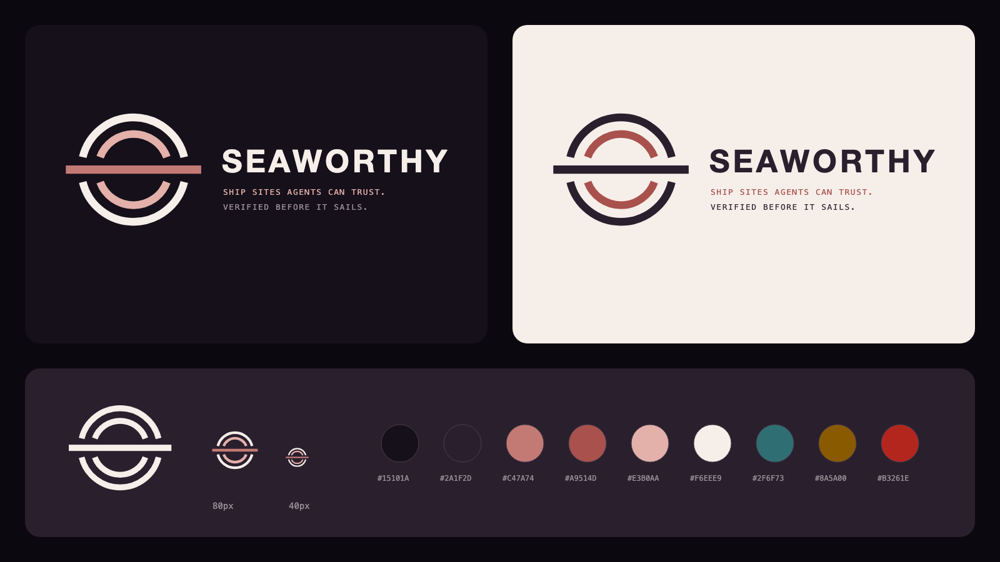

# Brand

Seaworthy's name, mark, palette, badge, and launch art. **Tagline:** Ship sites agents can trust.



Start with [BRAND_GUIDE.md](BRAND_GUIDE.md).

| Path | What |
| --- | --- |
| [`BRAND_GUIDE.md`](BRAND_GUIDE.md) | Logo rules, color, type, badge, voice |
| [`tokens.json`](tokens.json) · [`tokens.css`](tokens.css) | Colors, fonts, spacing: the source and its CSS |
| [`assets/`](assets/) | Mark in four variants (SVG and PNG) and the three status badges |
| [`templates/`](templates/) | Editable SVG sources for avatar, social preview, banner, marketplace art |
| [`exports/`](exports/) | PNG exports and the logo review sheet |
| [`export-presets.json`](export-presets.json) | Size and source for every export |

Everything except `tokens.json` and the guide is generated:

```bash
npm run build:brand     # SVGs, tokens.css, export presets
npm run export:brand    # PNGs (needs Chrome or Chromium)
```

`npm run check` fails when generated files drift from their source in `tools/brand/`.
